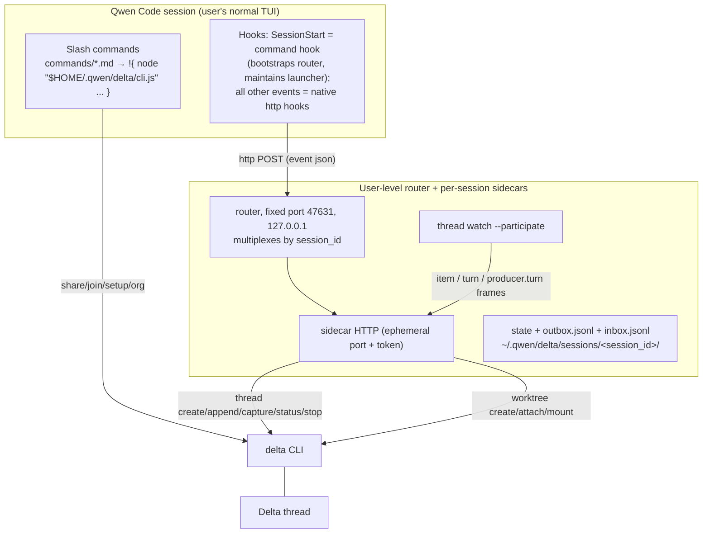

# Plan: Delta plugin for Qwen Code (`delta-qwen`)

Record Qwen Code sessions and their Git checkouts into Delta threads — share,
join, and teammate handoff, mirroring [delta-claude](https://github.com/zed-industries/delta-claude)
for Claude Code — using only the documented surfaces of both sides:

- **Delta side**: the Delta CLI thread contract (docs: *Build a Coding Agent Plugin*,
  contract v8; local CLI reports `{min:8, max:12}`).
- **Qwen side**: Qwen Code **extensions** (`qwen-extension.json` with inline
  `hooks`, `commands/*.md`, installable via `qwen extensions install|link`)
  and the documented **hook events** with stable payloads
  (`session_id`, `transcript_path`, `cwd`, `prompt_id`, `agent_id`).

Nothing reads or writes Delta's database directly; everything goes through the
`delta` CLI.

## Architecture



Three parts:

1. **Extension package** — `qwen-extension.json` registering one named hook
   per event and the slash commands. **SessionStart is the only command
   hook** (`node ${extensionPath}/dist/src/hook.js`): it bootstraps the
   router and maintains the `~/.qwen/delta/cli.js` launcher. Every other
   event is a **native `type: "http"` hook** POSTing to
   `http://127.0.0.1:47631/event` (loopback is exempt from Qwen's SSRF
   policy), so per-event delivery costs one localhost request, not a node
   spawn (measured below). Installed with `qwen extensions install <repo>`
   or `qwen extensions link .` for development.
2. **Hook dispatcher (`dist/src/hook.js`)** — reads the SessionStart event
   JSON on stdin, ensures the router is up (lock-guarded detached spawn +
   health wait), learns qwen's pid from its own process ancestry
   (`delta_qwen_pid` payload field — http-delivered events cannot walk the
   tree), POSTs the event, and exits. Fail-open: exit 0, no output on any
   failure — exit 2 would *block* startup. Short explicit timeouts (2–5 s).
   If invoked with a non-SessionStart event (tests, tools) it forwards it to
   the router unchanged.
3. **Router (`dist/src/router/router.js`, fixed port 47631, `127.0.0.1`)** —
   a user-level daemon multiplexing sessions by `session_id`: spawns
   per-session sidecars on first SessionStart (single writer in process, so
   no spawn race), forwards each event to the session's sidecar using the
   token in its `state.json`, relays the sidecar's response (PreToolUse deny,
   inbox context) back to Qwen, and respawns a dead sidecar once before
   failing open with `{}`. Idle-exits when no request arrived for 10
   minutes. Loopback-only, JSON-body-capped, session ids validated by
   charset; any local process could otherwise POST forged events — accepted
   v1 risk, documented (follow-up: user-scope settings hook with
   `${ENV}`-interpolated Authorization header, which http hooks support via
   `allowedEnvVars`).
4. **Session sidecar (`dist/src/sidecar/server.js`)** — detached node process
   per recorded session, spawned by the router, owning all long-lived work:
   Delta thread, outbox, `worktree mount` child process, `thread watch`
   child process, remote inbox, supersession flag. State lives in
   `~/.qwen/delta/sessions/<session_id>/` (survives qwen crashes and
   `/resume`); session dirs are `0700`, token/state files `0600`. Spawned
   fully detached (new session/process group, stdio ignored, unref) so
   Qwen's async-hook process-tree reclamation on exit cannot kill it.

### Why a router plus per-session sidecars

Delta needs a mount process running for the whole session and a watch process
running while turns run; hooks are short-lived with no memory. M1 originally
spawned a node dispatcher per hook event, but measurement on the target
machine killed that: dispatcher wall-clock was **336–397 ms p95** (bare
`node -e ""` alone is ~115 ms; process teardown after `exit()` adds
~150–280 ms), against a 100 ms budget. A direct localhost POST to the sidecar
measures **11 ms p50**, so per-event delivery moved to Qwen's native http
hooks. The http hook URL is static in the manifest, which forces a fixed-port
daemon; per-session sidecars stay separate so a sidecar crash costs one
session, teardown stays a clean process exit, and M1's state/lifecycle code
survives unchanged. The SessionStart command hook pays one ~400 ms spawn per
session to bootstrap the router and learn qwen's pid — acceptable at
session start.

### Lifecycle and orphans

The router polls nothing; the sidecar polls qwen's pid (learned from the
SessionStart command hook's ancestry and refreshed on resume).
On owner death it ends the watch and any open `capture`, lets Delta idle the
turn (Delta ends a running turn when the watch ends and the owner has exited),
keeps the mount for a grace period in case of `/resume`, then TERMs the mount
and exits. A new session that finds a stale state dir cleans it up after the
same liveness check. `SessionEnd` is the normal path; the poll covers SIGKILL
and crashes, where no hook fires.

## Repo layout (this worktree)

```text
.
├── qwen-extension.json        # name: delta-qwen, version, hooks, displayName
├── QWEN.md                    # one paragraph: what Delta sync is, commands list
├── commands/                  # Markdown commands (frontmatter + !{} via ~/.qwen/delta/cli.js)
│   ├── delta.md               # help/menu text
│   ├── delta-share.md         # /delta-share [emails...]
│   ├── delta-unshare.md
│   ├── delta-join.md          # /delta-join <link>
│   ├── delta-setup.md         # project policy (private | team | manual)
│   ├── delta-pause.md
│   ├── delta-inbox.md         # show pending remote activity
│   └── delta-org.md           # list | current | switch | invite | create
├── src/
│   ├── hook.ts                # SessionStart dispatcher: ensure router, forward event
│   ├── cli.ts                 # slash-command entry (share/join/setup/org/...)
│   ├── router/
│   │   └── router.ts          # fixed-port daemon: session multiplexing, sidecar spawn
│   ├── sidecar/
│   │   ├── server.ts          # HTTP API + lifecycle (spawn, orphan cleanup)
│   │   ├── state.ts           # state.json read/write, locking
│   │   ├── recorder.ts        # events → Delta records (mapping table below)
│   │   ├── outbox.ts          # persisted records, sequence numbers, receipts
│   │   ├── watcher.ts         # thread watch frames → inbox + supersession
│   │   └── mounts.ts          # worktree create/attach, checkout adoption, mount keepalive
│   ├── delta-cli.ts           # spawn `delta --json ...`, parse/validate output
│   ├── records.ts             # ACP v2 update builders
│   └── lib/                   # jsonl, paths, truncation, pid/proc helpers
├── test/                      # unit tests + fake `delta` CLI + fixtures
├── dist/                      # tsc output (built at release; linked for dev)
├── package.json  tsconfig.json
├── README.md  AGENTS.md  LICENSE (AGPL-3.0, see Decisions)
└── scripts/dev-check.sh       # link + command smoke (link mode) + typecheck + unit + fixture e2e
```

## Event → record mapping

Delta records: `schemaVersion:1`, consecutive `sequence` from 1, per-turn
`turnSequence`, ACP updates via `thread append`. Same `messageId` resent with
cumulative content = streaming.

| Qwen hook | Sidecar action |
| --- | --- |
| `SessionStart` | sources `startup`/`resume` (when policy records): ensure thread (`create` idempotent, source `delta-qwen`, external-id `session_id`), adopt checkout + start mount/watch (see Recording the checkout); auto modes apply share policy; `resume` reuses saved state. `compact`: no teardown, recording continues. `clear`: new conversation — if `session_id` is unchanged, suffix the external-id with a clear counter from state; never finalize the old thread beyond idle |
| `UserPromptSubmit` (with `submitted_prompt`) | `user_message` (dedupe by `prompt_id`); first prompt also sets the thread title via `session_info_update` (truncated); if idle → `state_update running` with `turnSequence = own sequence`; **inbox delivery**: pending remote activity returned as `additionalContext` (bounded, unique delivery id per batch), marked delivered only after the hook returns success |
| `MessageDisplay` | `agent_message` with `messageId a-<message_id>`, cumulative `displayed_text` resent each firing, final on `is_final` (Qwen debounces ~200ms). Hook stays **synchronous** — fast local POST, fire-and-forget event — to keep the is_final-before-Stop ordering; recorder keeps per-`message_id` terminal state (see ordering rules below) |
| `PreToolUse` | `tool_call_update` in_progress (title from `tool_name`, content from `tool_input`, truncated); edit-capable tools also run `thread capture start --tool-call-id <tool_use_id> --owner-pid <qwen pid>`; **supersession gate**: if superseded → `permissionDecision: "deny"` with reason "Delta teammate took over this thread" |
| `PostToolUse` / `PostToolUseFailure` | `tool_call_update` completed/failed with truncated `tool_response`/`error`, `duration_ms`; keyed by `tool_use_id`; `thread capture stop` for captured calls (stop may arrive before start — Delta handles it) |
| `Stop` | `state_update idle`; fallback `agent_message` from `last_assistant_message` only for messages with no `MessageDisplay` final (cancellation can suppress the final), reusing the turn's last seen `message_id` — never a fresh id, which would duplicate text |
| `StopFailure` | `state_update idle` + short agent_message note with error kind |
| `SubagentStart` / events carrying `agent_id` | child thread: `thread create --parent --shared-worktrees --external-id <session_id>:<agent_id> --name <agent_type>`; subsequent events with that `agent_id` append to the child reference |
| `SubagentStop` | child final `agent_message` (from `last_assistant_message` / `agent_transcript_path`) + idle |
| `SessionEnd` | flush outbox (`append --acknowledge local` if needed), `state_update idle` safety, TERM mount + watch, final state — except `reason=clear`, which is a conversation reset, not a session exit: no teardown, the conversation continues in the same thread (per-clear thread splitting via an external-id suffix is deferred to M4) |
| `PreCompact`/`PostCompact` | no Delta record in v1 (no `agent_thought`, see Decisions); `PostCompact.compact_summary` kept in state for future use |

**Streaming ordering rules.** A tool-using turn produces multiple messages,
each with its own `is_final`; tool-call-only model calls fire nothing. Stale
mid-stream posts can complete after the final (even after `Stop`): once a
`message_id` is final, ignore later posts for it; before final, accept only
longer cumulative text.

`--producer-name "Qwen Code"` on every append. Watch invocation (all flags
required): `delta --json thread watch <thread> --source delta-qwen
--external-id <session_id> --participate "Qwen Code" --owner-pid <qwen pid>`.
Delta ends the turn when the watch ends and qwen has exited — the sidecar
must end the watch on owner death (see Lifecycle and orphans).

### Recording the checkout

Qwen edits the user's own checkout, so the thread must adopt it — a fresh
`worktree create` directory would never see the edits:

1. `worktree create <repo>` (or reuse the thread's existing worktree) →
   `worktree attach --thread <id> <ref>`.
2. `worktree mount <ref> <cwd> --existing-checkout` adopts the session's
   checkout instead of creating a directory.
3. `thread mount --owner <session_id>` runs as the sidecar keepalive child.
4. `thread capture start/stop` around edit-capable tool calls names the
   edits with the `tool_use_id` used in the records (delta-claude's
   `hooks/recording/edit-capture.ts` is the reference).

   **Observed on delta 0.28.4 (live probe):** `thread capture` rejects every
   source except `claude-code` (`invalid_identity`, "capture supports only
   the claude-code source"), and error JSON arrives pretty-printed across
   multiple lines. The sidecar parses multi-line error objects, disables
   capture for the session on that error, and warns in the share output;
   edits then reach the thread unattributed. Revisit when Delta opens capture
   to other sources.

Non-Git cwd: record conversation only, note the limitation in status. A cwd
that is already a Delta-managed worktree (e.g. under `.delta/worktrees/`):
reuse its worktree reference instead of creating one — deferred to M4
hardening (M2 always creates; a deferral note lives here per the plan-first
rule).

### Outbox and recovery (per Delta docs)

- Records are saved to `outbox.jsonl` (numbered, immutable content) **before**
  sending; deleted only on `recorded`/`duplicate` receipts.
- Retry only when `error.retryable` is true, honoring `retry_after_ms`.
- `fenced` receipt or `producer.turn superseded` → set superseded flag, stop
  recording turn content, keep late output's original `turnSequence`.
- Offline: `thread create --organization <id> --visibility private` (returns
  without network; upload happens in background), then `append --acknowledge
  local` (from `/delta-setup` policy); surface `upload.state`/`reload_required`
  in `/delta-inbox` and status. M2 simplification: the outbox always
  acknowledges locally and relies on the 5s flush retry; policy-gated
  acknowledgment lands with M4. On `reload_required`, pause recording and
  print the remediation: open the thread in the Delta app → **Fork & Restore**
  or **Discard Changes**, or `delta thread fork` + `delta thread discard
  --force`.

### Sharing / joining / remote activity

- `/delta-share [emails…]` → ensure-recording, then `thread share
  --visibility organization` or `thread invite`; first share is gated by an
  explicit CLI consent step (see Project policy). Mid-session share backfills
  prior conversation from `transcript_path` JSONL with a qwen-specific parser
  (best-effort; on parse failure record a note and continue live).
  delta-claude syncs messages recorded while waiting for sign-in; its
  mid-session initial-export behavior is unverified — check
  `hooks/sharing/share.ts` before claiming parity.
- `/delta-join <link>` → access check (`thread status`), `thread mount
  --owner <session_id> --join` (explicit join, not background maintenance),
  print ready `directory`, then instruct the user to run qwen's built-in
  `/cd <directory>` (qwen commands cannot move the session themselves —
  documented UX limitation).
- Watch protocol: stream starts `ready` → current items → `live`. Keep items
  keyed by id, ordered by `after_id` (retain unresolved predecessors);
  `item` replaces, `item.append` extends, `remove` deletes; `turn`,
  `presence`, `worktrees` replace latest state; `producer.turn` reports
  supersession; `comment`/`comment.remove` update comments;
  `children`/`child`/`child.remove` track subthreads (Milestone 5). Items not
  produced by `delta-qwen` go to the inbox. The inbox is **injected as
  `UserPromptSubmit` `additionalContext` on the next turn** (never starts a
  turn itself) and viewable via `/delta-inbox`. Every injected block carries
  a unique delivery id: Qwen drops byte-identical context blocks after the
  first delivery per session, unconditionally. A cancelled turn's delivery
  stays undelivered. Fake-CLI frames fixture: delta-claude's
  `hooks/testing/fixtures/cli/thread-watch.frames.jsonl`.
- `worktrees` frame → restart `thread mount` with the same owner, swap mounts.

### Project policy

`/delta-setup` writes `.delta/settings.json`, excluded via `.git/info/exclude`
(no tracked-file churn): `{"mode":"private|team|manual","organization":"<id>"}`.
`team` shares new sessions with the org; `private` records locally (offline
create) until shared; `manual` records nothing until `/delta-share`. Consent
is a CLI gate, not model behavior: first use prints exactly what will be
uploaded and to whom, and sharing requires an explicit confirming invocation
(`/delta-share confirm`); the decision is persisted in state. Markdown
commands expand to prompts, so a model-mediated "ask first" is not reliable.

## Delta CLI bootstrap

- Resolve `delta` from `PATH`, then default install locations
  (`~/.local/delta.app/bin/delta`, Windows `%LOCALAPPDATA%\Delta\...`).
- `delta --json thread contract`: require `max >= 8` (plugin targets the
  documented v8 behavior; `min > 8` → tell user to update the plugin).
- Missing CLI → commands print install instructions (delta.dev). Auto-install
  (as delta-claude does) is a follow-up, not v1.

## Decisions and trade-offs

- **License AGPL-3.0-only** — the design ports structures and CLI-protocol
  logic from delta-claude (AGPL); keeping the same license is the safe default.
- **Supersession cannot truly cancel a running qwen turn** (no external Esc).
  v1 denies subsequent tool calls with a reason the model sees, notes it in the
  inbox/status, and the user presses Esc. Documented limitation.
- **Custom commands always run a model turn** in qwen (Markdown commands expand
  to prompts; `!{}` shell parts show a confirmation dialog — both are qwen
  security behaviors we keep). Command bodies stay terse: shell output + a
  one-line instruction, so the turn is trivial.
- **Command entrypoint** is `node "$HOME/.qwen/delta/cli.js"` — `!{}` runs in
  the session cwd, command markdown is not runtime-hydrated, and install-time
  `${CLAUDE_PLUGIN_ROOT}` rewriting skips linked extensions. The dispatcher
  maintains the launcher from its hydrated `${extensionPath}` on SessionStart;
  a stale launcher (extension uninstalled) fails with reinstall instructions.
- **Per-event delivery uses native http hooks** (decided in M1 by
  measurement): command-hook dispatch measured 336–397 ms p95 per event on
  the target machine — bare node startup (~115 ms) plus undici cold-init
  (~65–90 ms) plus slow process teardown (~150–280 ms) — versus 11 ms p50
  for a direct localhost POST. Trade-offs accepted: any local process can
  POST forged events to the loopback router (no per-request secret is
  possible with a static manifest URL; follow-up: user-scope hook settings
  with `${ENV}` header interpolation), and a router death mid-session loses
  events until the next SessionStart (no command hook fires to revive it;
  recording degrades, the supersession gate fails open).
- **`/resume` keeps `session_id`** (verified headless in M1: `qwen --resume
  <id>` reuses the id; `--fork-session` is the opt-in new-id path), so
  session state keys on `session_id` safely.
- **User-message provenance**: `UserPromptSubmit` also fires for continuation
  paths; only record when `submitted_prompt` is present, dedupe by
  `prompt_id`, cross-check against transcript on share. Accept imperfection in
  v1 and iterate against real sessions.
- **No `agent_thought` records in v1** — Qwen hooks expose no thinking stream;
  compaction events are observed but not recorded.
- **v1 targets macOS/Linux** (dev machines here). Windows path handling is
  kept in mind (path lib, no shell-isms in hooks) but untested; Windows
  installer orchestration is a follow-up.
- Out of scope v1: plugin self-updater, turn summarizer, status line (natural
  v1.1), qwen Worktrees / Multi-Agent Coordination interplay.

## Verification

Unit (`node --test` or vitest) with recorded hook fixtures + a **fake `delta`
CLI** (stub emitting canned `contract`/`create`/`append` receipts/`watch`
frames, like delta-claude's `hooks/testing/fake-thread-commands.ts`):

1. Record translation: fixture events → exact expected JSONL (sequences,
   turnSequence grouping, cumulative resend, tool truncation, capture
   start/stop ids, title update).
2. Outbox: `recorded`/`duplicate` deletes, `fenced` stops the turn,
   retryable-error backoff, crash → restart keeps sequence.
3. Watcher: fake frames (ready/live handshake, `after_id` ordering, `remove`,
   `children`) → inbox contents; superseded flag → PreToolUse deny JSON;
   `worktrees` frame → mount restart.
4. Ordering: stale MessageDisplay post after final is ignored; Stop fallback
   reuses the last `message_id`; identical inbox payloads re-inject with a
   fresh delivery id.
5. Lifecycle: SessionStart/End for `clear`/`compact` sources; owner-pid death
   → watch ended, mount grace, sidecar exit; concurrent dispatcher spawn race.
6. `npx tsc -p . --noEmit` clean.

Live end-to-end on this machine (has `qwen` 0.28.0 and `delta` contract 8–12),
in a throwaway Git repo:

1. `qwen extensions link .` → `/extensions list` shows `delta-qwen`; run
   `/delta` in link mode and verify the launcher path resolves (command
   smoke test).
2. `/delta-setup` → private; send a prompt that edits a file; verify in the
   Delta app: user message, streamed agent message, tool call, running→idle,
   and the checkout's file changes on the thread **attributed to the tool
   call** (capture).
3. `/delta-share` → org visibility; from a second checkout `/delta-join <link>`
   → mount dir, `/cd`, edit a file, verify it reaches the first checkout and
   the next qwen turn's injected context shows the teammate activity.
4. Supersession: start a turn from the Delta app while qwen works → verify
   tool denials with reason and correct `turnSequence` on late output.
5. Kill qwen mid-turn → sidecar survives (detached spawn), ends the watch,
   Delta ends the turn; restart qwen, `/resume` → same `session_id`, same
   thread, sequence continues (no restart from 1).
6. Offline: disconnect network, record a turn, reconnect → upload drains;
   `reload_required` surfaces in `/delta-inbox`.

## Milestones

1. **Scaffold**: repo, manifest + hooks registration (SessionStart command
   hook, others http), router, hook dispatcher, sidecar lifecycle (state
   dir, HTTP, orphan cleanup), `delta-cli.ts`.
   Asserted: `/resume` keeps `session_id` (headless, verified);
   link-mode command launcher resolves (link creates a directory with
   `.qwen-extension-install.json` metadata, not a symlink — the launcher
   does not depend on that); per-event latency measured 336–397 ms p95 via
   command hooks → **switched to native http hooks + fixed-port router**
   (direct POST 11 ms p50).
2. **Recording**: manual `/delta-share` path — checkout adoption
   (`--existing-checkout`), capture start/stop, thread/mount/outbox/append
   with user/agent/tool/turn records; receipts and retries.
3. **Remote**: watch (full frame protocol) → inbox, `UserPromptSubmit`
   injection with delivery ids, supersession gate, `worktrees`-frame mount
   swap.
4. **Commands & policy**: setup/auto modes, CLI consent gate, join,
   pause/unshare, org commands, mid-session backfill.
5. **Subagents** as child threads; polish, unit + fake-CLI suites.
6. **Docs & release**: README (install via `qwen extensions install <repo
   URL>`), AGENTS.md, release notes; live e2e pass per Verification.

## Key references

- Delta plugin guide: [delta.dev/docs/cli/build-a-plugin](https://delta.dev/docs/cli/build-a-plugin)
  (contract v8)
- Reference plugin: [zed-industries/delta-claude](https://github.com/zed-industries/delta-claude)
  (`hooks/recording/`, `hooks/sharing/`, `hooks/watch/`, `hooks/testing/`)
- Qwen Code hooks (events, I/O, config):
  `docs/users/features/hooks.md` in QwenLM/qwen-code
- Qwen extensions (manifest, `hooks` field, commands):
  `docs/developers/extensions/extension.md` + bundled `extension-creator` skill
